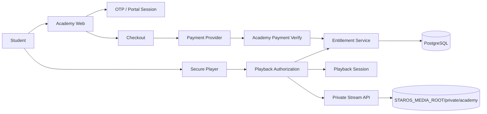

# Star Academy (آکادمی ستارگان)

## Architecture



## Host routing

- Public host: `academy.setareganplus.ir` (override with `ACADEMY_HOST`, `NEXT_PUBLIC_ACADEMY_URL`)
- Internal App Router prefix: `/academy/*` (see `lib/academy/host.ts`, `proxy.ts`)
- Apex `/academy/*` redirects to academy public origin

## Auth

- OTP via existing `lib/communication/otp` + SMS.ir
- Session: same opaque cookie as portal (`PORTAL_SESSION_COOKIE`) without requiring `PortalAccountLink`
- Auto-provision learner: `lib/academy/auth/provision-learner.ts`

## Commerce

- Orders: `AcademyOrder` / `AcademyOrderItem`
- Payment: dedicated `lib/academy/payment.ts`, payable type `ACADEMY_ORDER`
- Callback: `/payments/callback/academy`
- Mock dev checkout: `/payments/mock/academy-checkout/[sessionId]` (disabled in production)

## Video security

- Files under `private/academy/videos/` on `STAROS_MEDIA_ROOT` — never `/public`
- Playback requires `POST /api/academy/playback/session` + short-lived token
- Delivery via `/api/academy/playback/stream` (range) or HLS manifest when `hlsStoragePrefix` set
- Dynamic watermark in player (client overlay)
- **No DRM** in v1 — architecture allows future Widevine/FairPlay adapter

## FFmpeg / HLS (operations)

When ready for adaptive streaming:

```bash
ffmpeg -i input.mp4 -codec:v libx264 -codec:a aac -hls_time 6 -hls_playlist_type vod \
  -hls_segment_filename "seg_%03d.ts" master.m3u8
```

Upload segments under `private/academy/videos/{assetId}/hls/` and set `AcademyVideoAsset.hlsStoragePrefix`.

Run transcoding offline (worker/cron), not inside HTTP request handlers.

## Environment

See `.env.example` — `NEXT_PUBLIC_ACADEMY_URL`, `ACADEMY_MAX_DEVICES`, `ACADEMY_MAX_CONCURRENT_STREAMS`, `ACADEMY_PLAYBACK_TOKEN_TTL_SECONDS`, payment provider vars.

## Nginx snippet

```nginx
server {
    server_name academy.setareganplus.ir;
    location / {
        proxy_pass http://127.0.0.1:3000;
        proxy_http_version 1.1;
        proxy_set_header Host $host;
        proxy_set_header X-Forwarded-Host $host;
        proxy_set_header X-Forwarded-Proto $scheme;
    }
}
```

## Admin

`/admin/academy` — permissions `academy.view`, `academy.manage`
